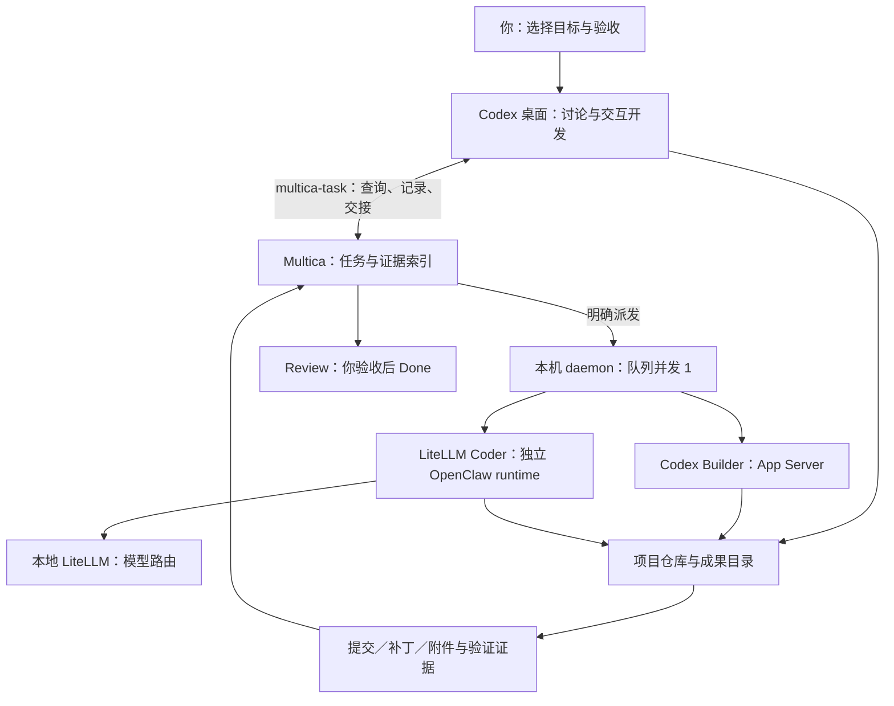
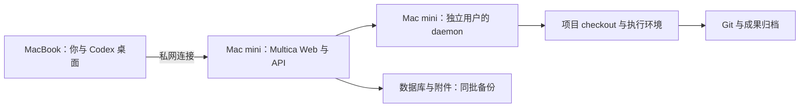

# 本机 Codex 与 Multica 协作实践

适用场景：一个人、一台 Mac、多个长期项目；后续迁往 Mac mini。核对日期：2026-10-31。本报告是配置建议，未变更 Agent、项目资源、权限、模型或任务状态，也未启动研发任务。

建议采用 **Multica 管目标、状态和证据索引，Codex 管具体执行，Git 与项目目录保存成果**。保留两种工作方式：需要与你讨论的工作在 Codex 桌面完成并回写任务；范围和验收明确的工作交给 Multica 后台 Agent。一个交付任务同一时间只有一个执行负责人。

## 从五个主流生态借鉴什么

以下选取 OpenAI、Anthropic、GitHub、Cursor、Google 五个主流生态的官方资料，并补充 Multica 与 MCP 官方文档。各家的配置语法不互通；表中最后一列是针对本机场景的综合建议。

| 来源与配置机制 | 官方实践要点 | 本机场景的取舍 |
|---|---|---|
| [OpenAI Codex：AGENTS.md](https://learn.chatgpt.com/docs/agent-configuration/agents-md)、[Skills](https://learn.chatgpt.com/docs/build-skills)、[App Server](https://learn.chatgpt.com/docs/app-server) | 分层加载项目说明；可复用流程按需加载；应用可管理 Codex 会话和执行事件 | 工程规则留在仓库；任务交接做成一个小流程；复用 Multica 已有的 App Server 适配 |
| [Anthropic：Claude Code best practices](https://code.claude.com/docs/en/best-practices) | 给出模型无法从代码推断的信息和可运行的验证；提示词与强制约束属于不同层次 | Issue 写清验收；关键验证依赖真实脚本和产物；“只读 Reviewer”说明不能当作文件权限控制 |
| [GitHub Copilot：任务最佳实践](https://docs.github.com/en/copilot/tutorials/cloud-agent/get-the-best-results) | Issue 范围清楚、验收完整；仓库说明包含构建和验证方法；评论用于迭代 | 一个 Issue 对应一个可验收成果；先交付 Review，再验收；借鉴流程，无需把本地任务全部迁到 GitHub |
| [Cursor：Agent 最佳实践](https://cursor.com/blog/agent-best-practices)、[Worktrees](https://cursor.com/docs/configuration/worktrees) | 不同任务隔离上下文；并行修改用独立 checkout；成果需审阅并整合 | 新的普通代码任务可用 worktree；现有 LexiFlow 原地执行合同继续保留；先控制并发，再考虑提速 |
| [Google Gemini CLI：项目上下文](https://geminicli.com/docs/cli/gemini-md/)、[Hooks](https://geminicli.com/docs/hooks/best-practices/) | 全局与项目上下文分层；钩子需要超时和适当权限 | 通用习惯放全局、项目约定留项目；未来同步脚本须有超时、去重、明确失败结果，不安装整套 Gemini 配置 |
| [Multica：Agent 配置](https://multica.ai/docs/agents-create)、[项目资源](https://multica.ai/docs/project-resources) | Agent 定义职责和交付方式；Project 资源确定执行目录与机器 | 一个长期产品/资料库一个 Project；Agent 按能力复用；项目资源和任务包决定具体边界 |
| [MCP：架构](https://modelcontextprotocol.io/docs/learn/architecture) | MCP 连接宿主与工具/数据服务，支持本地 stdio 和远程 HTTP | MCP 是工具接入层。当前 CLI 已够用，先用 CLI 加轻量流程；将来有跨客户端需求再评估专用 MCP |

这些实践共同支持“上下文清楚、任务有边界、验证可运行、结果可恢复”。本场景无需照搬云端集群、多模型竞赛或大量 Agent 自主互相派发。

## 当前本机实查

| 项目 | 2026-10-31 实查结果 | 对方案的影响 |
|---|---|---|
| Multica | CLI 0.6.3；固定源码 18fa9f7；daemon 运行，Codex runtime online | 已有执行接入，不必另造一个 Codex 调度器 |
| 本地 Codex CLI | `/opt/homebrew/bin/codex`，0.162.1 | 升级验证需同时记录 Multica 与 Codex CLI 版本 |
| 本机 Codex 配置 | `gpt-6-astra`，`xhigh`；`approval_policy=never`，`sandbox_mode=danger-full-access` | 这是配置文件快照，不代表所有桌面聊天都选同一模型 |
| Codex Builder | `gpt-6.1-sol`，`high`，Agent 并发 3 | 后台模型已显式指定，与桌面默认值不同并非故障 |
| 整机 daemon | `max_concurrent_tasks=1` | 当前后台实际受整机上限约束；不覆盖桌面手动执行 |
| 其他角色 | Coordinator、Validator、Reviewer、OpenClaw Assistant、LiteLLM Coder 均存在 | 已足够；Coordinator/Validator/Reviewer 的当前说明主要服务 LexiFlow，不应直接用于所有项目 |
| Projects | LexiFlow、ASD 资料整理 | 已按长期项目组织，延续此结构 |
| LexiFlow 资源 | GitHub 仓库，加本地研发目录；本地模式 `in_place`，绑定 MacBook-local | 同目录串行；正式发行目录保持独立授权入口 |
| ASD 资源 | 独立的 `~/.local/share/multica/asd-workspace` | 资料管理任务可继续使用隔离工作副本，避免写入原资料库 |
| LexiFlow v2.2 | TASK-27 至 TASK-34 保持 Backlog；项目说明明确首次交接验收待执行 | 角色配置存在不代表整条协作链已通过真实验收 |
| Skills 与自定义字段 | 六个 Agent 均无显式绑定的 workspace Skills；workspace 未列出自定义 Issue 字段 | 不等于没有本地继承技能；后续仅补确有价值的流程与字段 |
| Codex 到 Multica 入口 | `~/.local/bin/multica-task` 已存在 | 普通调用用 personal profile；后台调用保留注入的任务身份 |
| 同步现状 | 两个 Project 描述均未宣称已开启桌面聊天持续同步 | 应把桌面同步作为待建设能力，不能承诺现已自动回写 |

### 三个必须正确理解的继承关系

**MCP 空白不代表禁用。** 本机 Codex 配置列出 `computer-use`、`figma`、`node_repl`。当前版本在 Agent 保存了 MCP 配置后，会把本机 MCP 与 Agent 配置合并；空的 `mcpServers` 仍会继承本机条目。未保存时走工具原生继承路径。这只证明配置来源，不证明这些工具在无人值守的后台都能连接成功。[Multica 本地 MCP 配置](https://multica.ai/docs/daemon-runtimes#local-mcp-configuration)

**后台 Codex 不等于桌面当前聊天。** 固定版实现为每次任务准备 `CODEX_HOME`，复制部分本机配置、共享认证、安排任务会话。当前适配还会默认关闭后台任务的 Codex 原生多 Agent 与自动记忆。不要依赖桌面聊天历史或个人全局 AGENTS.md 自动成为后台完整上下文；重要输入应写进仓库规则与 Issue。参考本机源码 [codex_home.go](/Users/zhehan/.local/share/multica/server/server/internal/daemon/execenv/codex_home.go:23)、[codex_multi_agent.go](/Users/zhehan/.local/share/multica/server/server/internal/daemon/execenv/codex_multi_agent.go:12)。

**运行目录隔离不等于系统权限隔离。** 固定版 macOS 适配默认写入 `danger-full-access`；官方也把实际边界放在 daemon 所属系统用户、容器或 VM。服务端的 Podman 容器并没有自动把宿主机 Codex 关进同一容器。若以后希望长时间无人值守，优先给执行端单独的 macOS 用户及必要项目权限。[Multica 安全模型](https://multica.ai/docs/security-model)

## 推荐的工作结构



图中的多个箭头表示可选执行路径，不表示同时写同一目录。Codex 与 LiteLLM 是不同执行/模型路径；打通任务记录无需让 Codex 改走 LiteLLM。OpenClaw 的个人 Gateway 可继续作为任务录入入口；后台 LiteLLM Coder 继续使用已有隔离 runtime。

### 模式一：你与 Codex 一起做

适合探索需求、复杂调试、方案讨论、需要频繁选择的改动。

1. 在对应 Project 创建或找到 Issue。负责人保持用户或未分派，记录当前 Codex 聊天 ID。
2. Codex 在实际项目目录工作。读 Issue 和项目规则，核对仓库身份、分支与未提交变更。
3. 只在开始、遇到实质阻塞、产生可验收交付这几个节点回写。无需逐条复制聊天。
4. 回写产物位置、输入版本、验证结果、剩余问题；交付进入 Review。
5. 用户验收；已有仓库验收合同继续适用。

**同一事项已在桌面执行时，不再给后台 Builder 分配一次同样的工作。** 记录任务与启动任务是两个操作。

### 模式二：明确交给后台做

适合范围明确的修复、测试补充、文档整理或有固定输入的资料批次。

1. Issue 写清目标、输入、允许改动范围、验证方法、成果保存方式和时限。
2. 检查没有同一输入的活动 run，也没有桌面在写相同 checkout。
3. 明确分派给 Builder 或 LiteLLM Coder，由 daemon 创建执行记录。
4. Agent 完成直接验证，保存提交/补丁/附件，再交付 Review。
5. 需要独立验证或审查时，按该项目规则交接已有角色；普通小任务由用户直接审阅即可。

同一个 Issue 可以有多个 run。`run completed` 仅表示执行结束；Issue Done 表示其验收要求已满足。某些统计会把取消和完成共同视为闭合，不能用进度条代替业务验收。


阻塞先写清缺项与接手人，并使用项目现有状态/标签，不为了一个人管理任务增加一套复杂状态机。

## Multica 侧建议配置

| 配置位置 | 建议值或约定 | 优先级 |
|---|---|---|
| Workspace | 保留一个 Feipi 工作区，存少量共同约定 | 现在 |
| Project | 一个长期产品或资料库一个 Project；版本/批次作为父 Issue；交付拆为子 Issue | 现在 |
| Project Resources | 核对 canonical 路径、仓库 origin、daemon、execution_mode；项目描述写明验收入口 | 现在 |
| Agent Instructions | 写角色职责、交付、何时停止；具体版本合同移交给 Issue 与仓库文件维护 | 逐步整理 |
| 模型与 thinking level | 后台保留明确的配置；当前模型差异按任务需要选择，不以桌面默认覆盖所有角色 | 保持 |
| 并发 | daemon 保持 1；建议将 Builder 上限也统一为 1，减少未来提高整机上限时的意外并发 | 优先建议，未修改 |
| Access | 一人使用保留 private；不为跨角色调用问题放宽为全工作区公开 | 保持 |
| MCP | 审核实际继承列表；编码角色只保留所需工具；不能用空配置实现全禁用 | 优先核查 |
| Skills | 仓库工程技能以 Git 为源；只把真正跨项目的流程绑定到 Agent，避免多处维护同一份规则 | 按需 |
| Issue 模板 | 增加执行方式、项目身份、来源标识、聊天/run 关联及成果证据 | 优先 |
| Wakeups | 只有启用协调流程后，使用绑定具体运行、有限期限的事件唤醒 | 后续 |

建议新增的字段最多先用三个：`执行方式`（桌面/后台/仅记录）、`来源标识`（重试去重）、`Codex 聊天`（追溯）。它们可先放模板正文；如果需要筛选再升级为自定义字段。来源标识查询去重是工作约定，不是数据库层的原子幂等保证。

Project 的资源不能代替文件访问控制。LexiFlow 当前原地串行模式符合其既有身份及发行规则，本次不建议直接切换。新建普通 Git 项目如需边聊天边让后台改代码，可先验证 worktree，再启用；没有 Git 的资料目录用独立工作副本或串行原地方式。[Multica 项目资源](https://multica.ai/docs/project-resources)、[Cursor Worktrees](https://cursor.com/docs/configuration/worktrees)

Multica 中从本地导入 Skill 是快照，之后本地改动不会自动更新导入版本。若选择导入，要保留源路径/版本并有明确更新动作；不要假设双向同步。[Multica Skills](https://multica.ai/docs/skills)

## 本机 Codex 与 Agent 侧建议配置

### 分清四层信息

| 信息 | 放在哪里 | 例子 |
|---|---|---|
| 跨项目习惯 | 全局 AGENTS.md 中少量规则 | 中文交付、保留无关改动、用 multica-task 处理明确关联的任务 |
| 项目工程规则 | 项目 AGENTS.md 与现有 harness 文档 | 构建测试入口、仓库身份、发布规则、成果目录 |
| 稳定的操作流程 | 一个按需调用的 Multica 协作 Skill | 查任务、记录进展、准备交接、回写证据 |
| 本次具体目标 | Issue 描述与评论 | 输入版本、修改范围、截止时间、验收和交付 |

不要把所有项目的规则塞进全局 AGENTS.md，也不要把某一版本几十条任务永久复制进通用 Builder 的角色说明。已有 LexiFlow 特殊规则只在其范围内保留；通用化之前先核对该仓库合同。

建议的全局说明片段如下，供后续实施审阅，不直接覆盖现有文件：

```text
用户明确关联 Multica 任务时，使用 ~/.local/bin/multica-task。
开始前读取目标 Issue 与项目规则，核对项目目录及当前执行者。
区分仅记录、桌面执行、后台交接；记录负责人时不得隐式启动后台。
只在关键进展、阻塞和交付时回写，记录可核验的成果与验证结果。
遵循项目自己的验收和 Git 规则；运行结束不自动等于任务验收通过。
后台使用注入的任务凭据，不读取或复制个人 profile token。
```

该片段主要改善桌面入口。Multica 后台有自己的运行提示与配置生成逻辑，应通过任务包、仓库说明及适用技能保证同样的工作约定，不假设全局文件自动完整继承。

### 协作 Skill 只需要覆盖少量操作

先定义工作流，不急于开发长期运行的同步服务：查询任务 → 校验项目/执行方式 → 记录或交接 → 回写交付。输入只要求任务编号，或项目加目标；只有用户要后台执行时才进入派发分支。脚本处理 JSON、去重、失败重试边界，模型负责理解目标与总结证据。

自动回写若失败，应报告“任务工作已完成，但同步失败”及可重试数据；先查询实际状态再重试，不重复创建 Issue、评论或 run。只读取当前任务所需上下文，不全量扫描所有项目与聊天。

MCP 暂不作为首选新增组件：本机 CLI 已经具备查询、更新、分派和附件入口，`multica-task` 也已解决本机/后台认证选择。若以后确需给不能执行 CLI 的客户端使用，可再把这些有边界的操作封装为 MCP；无需同时维护两个写入实现。

### 无人值守角色的实际约束

角色说明负责行为约定，系统用户/挂载范围负责权限边界。当前主机是个人用户全权限模式；如先继续使用，适合已理解范围的本地任务。准备持续无人值守时，在独立执行用户下只放必要仓库、凭据、CLI 和模型入口，验收后再让日常后台任务使用新 runtime。单独设置桌面 Codex 的 sandbox 值不能证明 Multica 后台也使用它。

现阶段不打开后台 Codex 原生嵌套多 Agent。Multica 固定版适配默认关闭该能力，理由是父线程结束与子线程生命周期不能直接等同。复杂协作使用 Multica 已有角色与 run 记录，并保持有界交接；普通任务保持单执行者。[本机适配说明](/Users/zhehan/.local/share/multica/server/server/internal/daemon/execenv/codex_multi_agent.go:12)

## 日常怎么说、怎么操作

可以直接对 Codex 说：

- “把这个需求记到 LexiFlow 的 Multica 项目，先放 Backlog，仅记录。”
- “我在当前 Codex 聊天处理 TASK-XX。先核对任务与目录，关键节点回写，不另派后台。”
- “为 TASK-XX 准备后台工作包，列出输入、范围、验收和交付位置。”
- “按已确认范围把 TASK-XX 交给 Codex Builder，检查真实 run 是否创建。”
- “检查 TASK-XX 的实际成果和验证证据，指出还差哪项验收。”

以下命令已对照本机 0.6.3 CLI help；是示例，本次没有执行任何写入命令。将占位值替换成真实项目 UUID、任务编号和当前目录文件。`task.md` 需包含完整任务包。

```bash
# 只读查询
multica-task project list
multica-task issue get TASK-123
multica-task issue runs TASK-123

# 仅记录：不指定 Agent
multica-task issue create --project <project-uuid> \
  --title "交付目标" --status backlog --description-stdin < task.md

# 记录归属，明确不启动
multica-task issue assign TASK-123 --to "Codex Builder" --no-start

# 明确交给后台时才使用，会请求派发
multica-task issue assign TASK-123 --to "Codex Builder"

# 仅更新状态，禁止这次更新附带启动
multica-task issue update TASK-123 --status in_review --no-start
```

评论可能因真正的 Agent mention、回复目标或已注册 wakeup 触发执行。评论命令本身没有 `--no-start` 开关，不能用它假造“纯备注”的保证。后台由评论唤醒时，回复必须带真实触发评论的 `--parent`；先检查现有线程和触发规则，再发交付评论。[Multica 评论](https://multica.ai/docs/comments)

建议交付记录保持短而完整：

```text
任务 / 执行方式 / 真实 run 或聊天标识：
项目目录与输入基线：
完成的改动与可恢复成果：
验证命令、结果及证据位置：
未覆盖内容 / 阻塞：
下一步：Review 或具体接手动作
```

临时路径不能作为唯一交付。代码至少保留可恢复的提交或补丁；新文件需要纳入交付；资料任务保留输出文件和来源索引。关闭 Issue 前检查成果仍可取得。运行目录存在回收机制，而链接的原始本地目录不会被当作临时执行目录删除。[Multica 清理与保留](https://multica.ai/docs/daemon-runtimes#cleanup-and-retention)

## 后续 Coordinator 应如何使用

当前 LexiFlow 已有协调、验证与审查角色，先保留其专用范围。不要因为新增了角色就自动扩大执行授权。

若后续启用自动推进：Coordinator 每轮读取父任务和原始证据，只做一次派发或推进决定；取得真实 run ID 后注册对应终态 wakeup，然后结束本轮。整机并发为 1 时，Coordinator 占着执行位等待 worker，可能使 worker 无法开始。事件唤醒让等待期间不占用一次 Agent 运行。[Multica Issue wakeups](https://multica.ai/docs/issue-wakeups)

使用一次性、有限期、绑定具体运行/来源的条件；普通回传和 wakeup 二选一作为推进信号，避免反复互相 @。取消属于执行终态，但不算验收通过。是否能签发独立验收还取决于仓库规定的真实身份与证据入口，不能仅凭不同 Agent 名称认定独立性成立。

## 迁往 Mac mini

推荐目标：MacBook 保留桌面交互入口，Mac mini 承担 Multica 服务与后台执行。只有确认需要时才把 LiteLLM 一并迁移；它是模型入口，和任务数据库是不同组件。



服务地址从 localhost 迁到可达的私网地址；优先私网/VPN与访问控制，不把数据库端口直接暴露。Project 的绝对路径和 daemon ID 是机器相关的，必须重新绑定；不能仅复制网页数据就认为执行端完成迁移。

迁移顺序沿用现有运维方案：排空任务 → 同批备份数据库、附件和必要密钥 → 新机恢复同版本 → 安装 CLI/依赖及最小凭据 → 新建机器 runtime 身份 → 重绑项目资源 → 分别验证查询、模型请求、文件交付、状态回写 → 切换主要执行机。迁移稳定之后再升级版本。

Mac mini 与 MacBook 使用不同 checkout，成果通过 Git/明确的文件交付同步；同一任务同一时刻只由一台执行机负责。首次新机任务要验证独立用户能访问模型、项目和 API，并能交付可恢复产物。daemon 运行正常、API ready 或 LiteLLM ready 都不能代替完整任务验收。

现有操作入口见 [本机运维 README](/Users/zhehan/Documents/tools/llm/feipi-agent-kit/components/multica/README.md) 和 [Mac mini 迁移流程](/Users/zhehan/Documents/Playground/mac-mini-migration/plans/10-multica-operations.md)。本次未执行跨机恢复或无人值守权限验收。

## 建议实施顺序与验收

| 顺序 | 具体工作 | 通过条件 |
|---|---|---|
| 1 | 统一任务模板、桌面回写约定、项目身份核对，保持 daemon 并发 1 | 桌面处理一条样例任务，只生成一条关联记录，无意外后台 run |
| 2 | 做一个小型 Multica 协作 Skill；核对后台 MCP/Skills 实际列表 | 桌面和后台都找到正确项目，回传不重复，不依赖缺失的桌面专属工具 |
| 3 | 独立测试项目验证后台交付与失败接手 | 文件/补丁可恢复，验证证据可查，失败准确记录，完成进入 Review |
| 4 | 按需验证 Coordinator 的一次派发与一次唤醒 | 并发 1 不阻塞下游，无自触发循环，不以 run 结束自动关单 |
| 5 | 新普通项目试点 worktree；Mac mini 准备独立执行用户 | 主目录未被混写，依赖与验证可运行，成果可以整合 |
| 6 | 在新机恢复同版本并切换执行端 | 数据、附件、密钥配套；新身份与路径正确；一条真实任务从领取到验收闭环 |

建议先完成前两步。现有部署已经解决“能连接和执行”，下一阶段最有价值的是让你无论从哪个项目、哪个 Codex 聊天开始，都能明确知道任务在哪里、由谁执行、结果在哪里，以及还缺什么验收。

## 核对依据

本机依据：`multica-task --version`、`codex --version`、Agent/Project/Resource/Issue/Runtime 只读查询、CLI help、按字段筛选 Codex 与 daemon 配置，以及固定版上游源码。未输出个人 token、密钥或验证码。

源码核对点：

- [MCP 合并规则](/Users/zhehan/.local/share/multica/server/server/internal/daemon/runtime_mcp.go:26)
- [Codex 配置复制与任务 HOME](/Users/zhehan/.local/share/multica/server/server/internal/daemon/execenv/codex_home.go:23)
- [macOS sandbox 选择](/Users/zhehan/.local/share/multica/server/server/internal/daemon/execenv/codex_sandbox.go:33)
- [后台多 Agent 生命周期处理](/Users/zhehan/.local/share/multica/server/server/internal/daemon/execenv/codex_multi_agent.go:12)
- [Agent 模型传入 thread/start](/Users/zhehan/.local/share/multica/server/server/pkg/agent/codex.go:2084)
- [本机认证选择 wrapper](/Users/zhehan/Documents/tools/llm/feipi-agent-kit/components/multica/bin/multica-task:3)

网上资料为检索日可见版本，可能领先于本机 0.6.3。上文涉及本机行为时以实际 CLI 和固定版代码为依据；配置静态核对不能证明新角色交接或新机迁移已通过运行验收。
